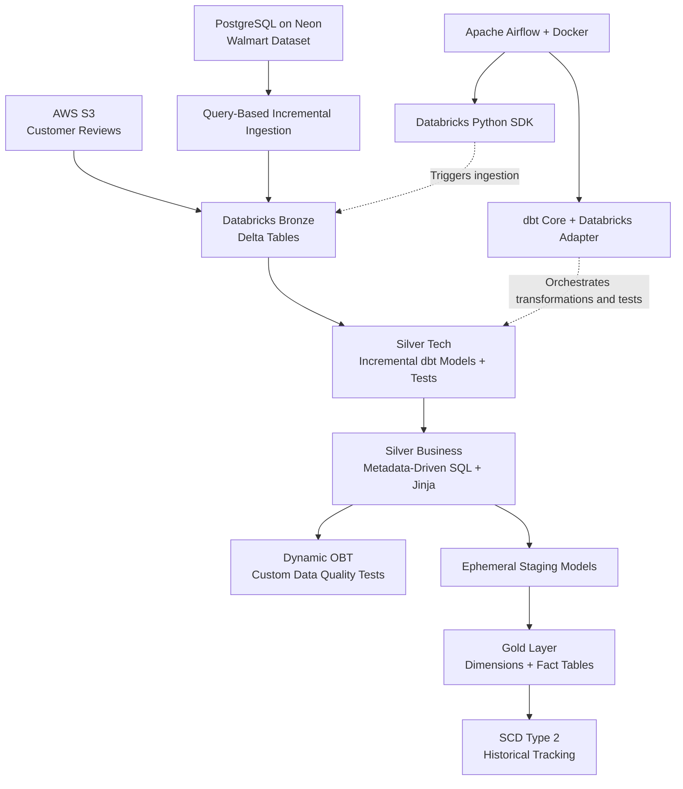

# Walmart Data Engineering Pipeline

An end-to-end data engineering project built using **AWS S3, PostgreSQL (Neon), Databricks, dbt, and Apache Airflow**. The project focuses on incremental data ingestion, metadata-driven transformations, dimensional modeling, data quality testing, and automated pipeline orchestration.

## 🏗️ Architecture

## 🔄 Project Workflow

### 1. Data Ingestion — AWS S3, PostgreSQL and Databricks

- Use PostgreSQL hosted on Neon as a source for the Walmart dataset and AWS S3 for customer review files.
- Create the raw schema and tables for CSV data in the Databricks Bronze layer.
- Implement query-based, CDC-style ingestion to incrementally load source changes.
- Ingest customer reviews from S3 alongside the database ingestion workflow.
- Use **Delta Lake** as the open table format for reliable lakehouse storage.

### 2. Silver Layer — Incremental Transformations

- Define dbt sources and configure model materializations at the project, model, or folder level.
- Build incremental dbt models to process new and changed records instead of reprocessing the entire dataset.
- Transform and organize data in the `silver_tech` layer, with data quality tests for the models.
- Build the `silver_business` layer using metadata-driven SQL templates and Jinja.

### 3. Metadata-Driven Pipelines and OBT

- Store transformation configurations in metadata and use Jinja to generate dynamic SQL queries.
- Build a reusable **One Big Table (OBT)** pipeline that can accommodate additional tables through configuration rather than repeatedly writing separate SQL models.
- Develop custom data quality tests for the OBT to validate transformed data.

### 4. Gold Layer — Dimensional Modeling

- Use dbt ephemeral models as lightweight staging queries without persisting separate physical tables.
- Build dimension and fact tables from the transformed data.
- Generate surrogate keys for dimension records and join them into fact tables.
- Implement **Slowly Changing Dimension Type 2 (SCD Type 2)** to preserve historical changes using effective timestamps and record-version tracking.
- Use a composite key for the fact table where the grain is defined by a combination of dimension keys.

### 5. Apache Airflow and dbt Integration

- Integrate dbt with Apache Airflow to orchestrate ingestion, transformations, and testing.
- Build a custom Docker image with the required dbt Core and Databricks adapter dependencies.
- Use the Databricks Python SDK to communicate with Databricks from the ingestion DAG.
- Configure source freshness checks and manage the pipeline through dependent Airflow tasks.
- Resolve dbt command availability and parsing issues in the containerized environment, and verify source discovery and model tests.

## 🛠️ Technology Stack

| Technology | Purpose |
|---|---|
| AWS S3 | Customer review file storage and ingestion |
| PostgreSQL (Neon) | Source database |
| Databricks | Data processing and lakehouse |
| Delta Lake | Open table format |
| dbt Core + Jinja | SQL transformations and dynamic models |
| Apache Airflow | Workflow orchestration |
| Docker | Custom execution environment |
| Python & SQL | Ingestion, transformations, and automation |

## 🚀 Future Enhancements

- Build an **SQL chatbot using MCP** to let users query PostgreSQL through natural-language questions, reducing routine dependency on the DBA.
- Expand pipeline monitoring, automated data quality checks, and ingestion coverage.

## 🔐 Configuration

Configure database connections, Databricks host and credentials, and other environment-specific settings securely using environment variables or Airflow connections. Do not commit API tokens, passwords, or private configuration files to GitHub.

